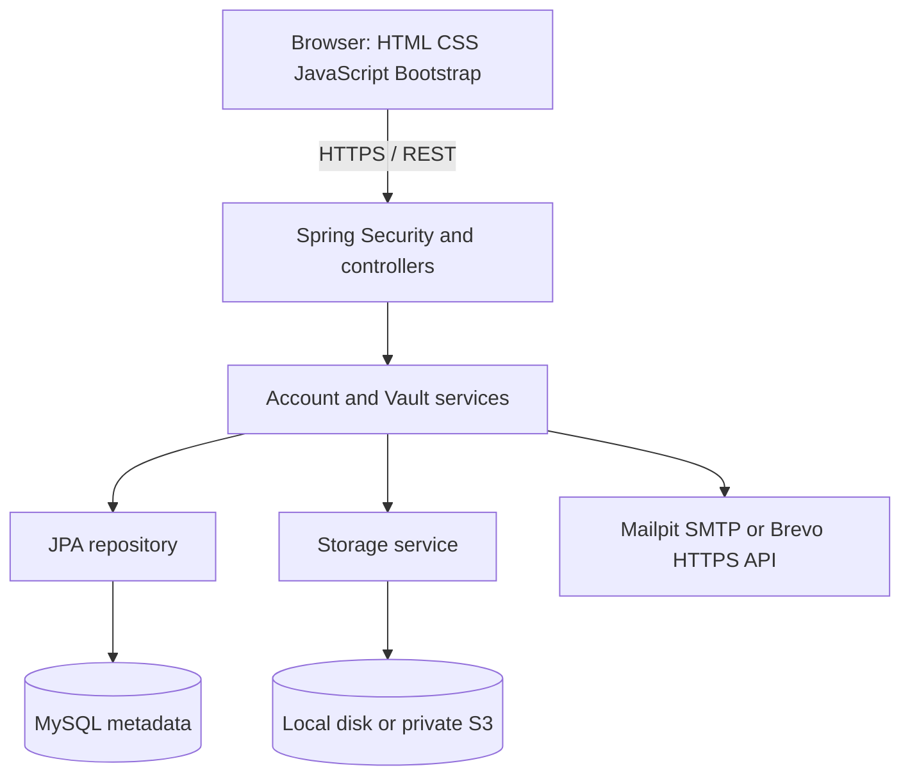

# CloudVault

A personal cloud file storage and sharing application built with Java and Spring Boot. CloudVault lets users organize files in folders, track storage usage, and grant temporary read-only access to files without exposing the storage bucket.

> **Release status:** source implementation candidate, not a verified production release. Java syntax and configuration checks passed; Maven compilation, real backend integration tests, Docker, browser and cloud tests could not run in the delivery environment. Run the verification checklist before publishing. See [test report](docs/TEST_REPORT.md).

## Features

- Email/password accounts, email verification, password reset and session-based authentication.
- Private workspace per user, plus a read-only demo account.
- Upload multiple files (sequential requests), drag-and-drop, download, rename, move, favorite and search.
- Nested folders, quick-access pins and recently opened folders.
- Browser preview for PDF, PNG, JPEG, GIF and WebP; other files download only.
- Temporary share links, direct sharing with verified users, expiration and revocation.
- Recycle bin, restore, permanent deletion and real storage statistics.
- Local filesystem storage or a private AWS S3/S3-compatible bucket.
- 50 MiB per file, 500 MiB per user (including trash); a configurable global storage cap and registration cap for budget control.

## Technology stack

Java 21 · Spring Boot 3.5.16 · Spring Security · Spring Data JPA / Hibernate · MySQL 8.4 · HTML, CSS, JavaScript, Bootstrap 5 · AWS SDK for Java v2 · Docker Compose · Maven · JUnit / MockMvc · Mailpit / Brevo

## Start locally (Windows / Docker Desktop)

1. Install and start Docker Desktop (WSL 2 backend). Extract the project and open the `CloudVault` folder in VS Code.
2. Open Terminal → New Terminal (PowerShell) and run:

   ```powershell
   Copy-Item .env.example .env
   notepad .env
   ```

   Fill `DB_PASSWORD` and `MYSQL_ROOT_PASSWORD` with two different new strong passwords for this fresh database. Do not use or change passwords from an existing CloudVault installation. Keep the other defaults for local mode. Do not commit `.env`.

3. Run:

   ```powershell
   docker compose up --build -d
   docker compose ps
   docker compose logs -f app
   ```

4. Open http://localhost:8080. Select **Explore read-only demo** or register with an email and password. Open http://localhost:8025 (Mailpit) to read the verification email, click its link, and sign in. Mailpit captures emails locally; it does not deliver to real inboxes.
5. Stop with `docker compose down` (volumes persist). Never run `docker compose down -v` unless you intend to erase this project's database and files.

Health check: http://localhost:8080/actuator/health. If port 8080 is busy change `APP_PORT` and `BASE_URL` together in `.env`. More details: [local setup](docs/LOCAL_SETUP.md).

## Design

The workspace follows the supplied reference: a black sidebar, white main canvas, three pastel folder cards, quick access, recent uploads and a storage gauge. Layout adapts to smaller screens. [Original design reference](docs/design-reference.png) is not a screenshot of the rebuilt app. Capture actual application screenshots after running it, rather than presenting fixture screenshots as a live application.

## Architecture



The frontend is served by Spring Boot from the same origin. File bytes are separate from relational metadata. Session cookies and CSRF tokens protect state-changing endpoints. All file and folder IDs are checked against the authenticated user's identity; public link tokens are random and only their SHA-256 hashes are stored.

## Project structure

```text
CloudVault/
├── src/main/java/com/cloudvault/
│   ├── config/       # Security and authenticated principal
│   ├── model/        # JPA entities
│   ├── repository/   # EntityManager and parameterized JPQL
│   ├── service/      # Business logic, storage, mail, demo data
│   └── web/          # REST controllers and error mapping
├── src/main/resources/
│   ├── application.yml
│   └── static/       # Dashboard, auth and public sharing pages
├── src/test/         # MockMvc integration test cases
├── scripts/          # Java parse and UI fixture smoke tests
├── docs/             # Setup, deployment, API and interview guides
├── .github/workflows/ci.yml
├── Dockerfile
├── compose.yaml
├── render.yaml
├── .env.example
└── pom.xml
```

## Documentation

- [Local setup and troubleshooting](docs/LOCAL_SETUP.md)
- [Deployment and AWS account guide](docs/DEPLOYMENT.md)
- [GitHub publishing](docs/GITHUB_GUIDE.md)
- [API documentation](docs/API_DOCUMENTATION.md) and [Postman collection](docs/CloudVault.postman_collection.json)
- [Database schema](docs/DATABASE.md) and [reference SQL](docs/schema.sql)
- [Architecture and code walkthrough](docs/ARCHITECTURE.md)
- [Testing / limitations](docs/TEST_REPORT.md)
- [Resume and GitHub descriptions](docs/RESUME.md)
- [Interview guide](docs/INTERVIEW_GUIDE.md)

## Tests

With Java 21 and Maven installed:

```bash
mvn clean verify
```

The integration tests use H2 in MySQL compatibility mode, a temporary directory and mocked email delivery. This is not a substitute for running on MySQL, S3 and real email. GitHub Actions runs the Maven suite on push and pull requests. See the testing document for full checks and remaining work.

## Public demo

The recommended no-cost **temporary** demo is a Cloudflare Quick Tunnel to your local Docker application. A longer-lived public URL can use Render free compute, a MySQL-compatible TiDB Cloud Starter database, private S3 storage and Brevo transactional email. AWS credits expire; no provider guarantees indefinite free hosting. See the deployment guide for free-tier limitations and R2 alternative.

CloudVault is an educational portfolio application, not a commercial storage service. Do not upload sensitive data or invite unrestricted public usage until the deployment and security checks have passed. There is no malware scanning, distributed rate limiting, multi-instance coordination or automated recovery of orphan objects. Review dependencies before public exposure.
