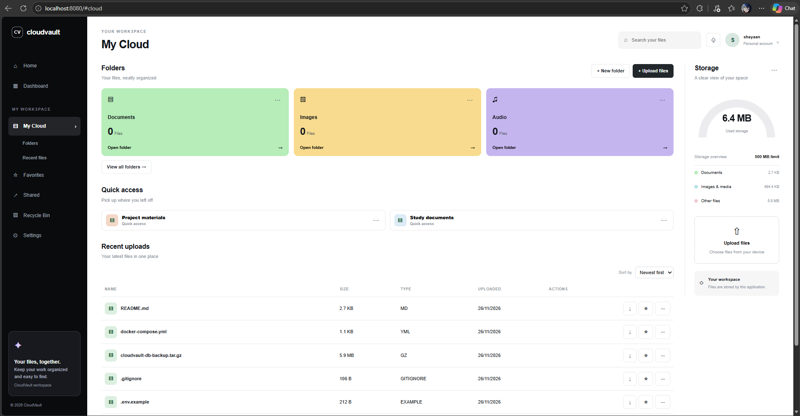
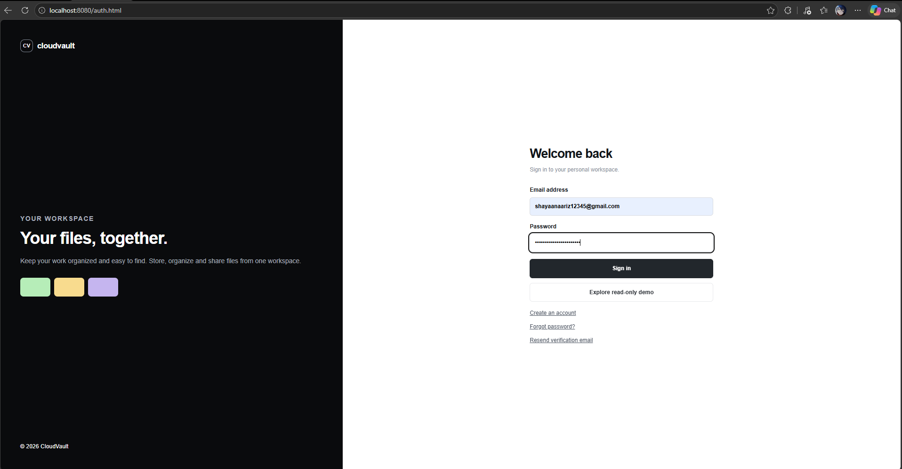
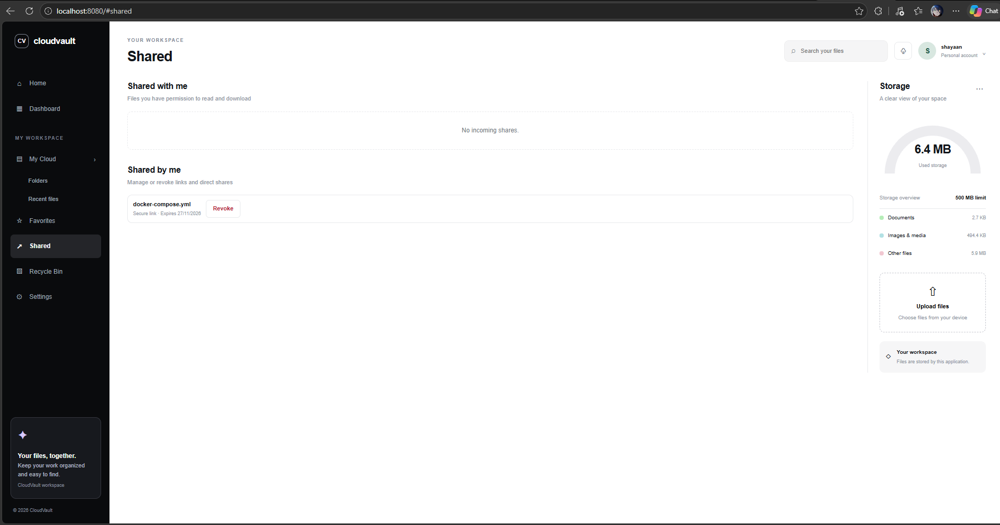
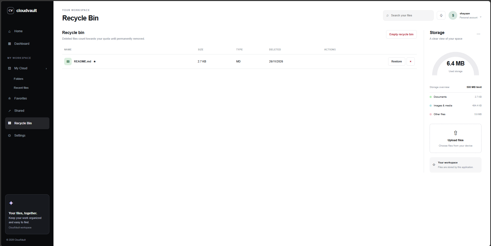
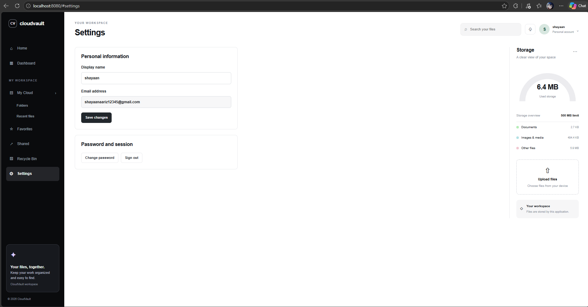
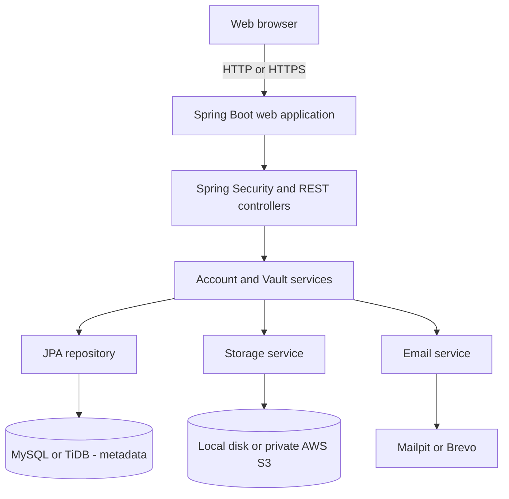

# CloudVault

CloudVault is a full-stack file storage and sharing application built with Java and Spring Boot. It provides a personal workspace where users can upload, organize, preview, download and share files while managing their storage usage.

**[Live Demo](https://cloudvault-hplj.onrender.com)** | **[Source Code](https://github.com/shayaan16/CloudVault)** | **[API Documentation](docs/API_DOCUMENTATION.md)**

> The hosted application runs on Render's free instance, so the first request after inactivity may take a minute or longer. Online registration and verification email delivery are currently unresolved. Email verification and password reset have been tested successfully in the local environment. The read-only demo is available as a feature; its hosted behavior still needs verification.

## Application Preview


## Application Preview

### My Cloud



<details>
<summary>Login Page</summary>



</details>

<details>
<summary>File Management Options</summary>


</details>

<details>
<summary>File Sharing</summary>



</details>

<details>
<summary>Recycle Bin</summary>



</details>

<details>
<summary>Account Settings</summary>



</details>

<summary>Recycle Bin</summary>


</details>

<details>
<summary>AWS S3 storage</summary>


</details>

## Features

- Email/password registration, email verification, login and password reset.
- Private user workspaces and a restricted, read-only demo account.
- Multiple file uploads, drag-and-drop, downloads, renaming and moving files.
- PDF and supported image previews, search, favorites and recent files.
- Nested folders, quick access and folder management.
- Expiring share links, direct sharing with registered users and access revocation.
- Recycle bin, file restoration and permanent deletion.
- Storage usage tracking with a 50 MiB file limit and 500 MiB per-user quota, including trash.
- Configurable local filesystem or private AWS S3 storage.

## Technology Stack

| Layer | Technologies |
| --- | --- |
| Backend | Java 21, Spring Boot, Spring Security, REST APIs |
| Frontend | HTML5, CSS3, JavaScript, Bootstrap 5 |
| Data access | JPA, Hibernate, EntityManager, JPQL |
| Database | MySQL 8.4 (local), TiDB Cloud Starter (hosted, MySQL-compatible) |
| File storage | Local filesystem, Amazon S3, AWS SDK for Java v2 |
| Email | Mailpit (local testing), Brevo transactional email API |
| Build and deployment | Maven, Docker, Docker Compose, Render |
| Testing | JUnit, MockMvc, Postman, GitHub Actions |

## System Architecture



The frontend is served by Spring Boot. The backend handles authentication, ownership checks, file operations and sharing permissions. Relational storage holds account information, folder relationships and file metadata; file contents are stored separately. S3 objects use generated identifiers rather than the original filenames.

## Security

- BCrypt password hashing and session-based authentication.
- CSRF protection for state-changing requests and HTTP-only session cookies.
- User ownership checks on private files and folders.
- Random, expiring share tokens stored as SHA-256 hashes.
- Private S3 bucket access through restricted IAM credentials.
- File size limits and configurable account and storage quotas.
- Environment-based configuration for credentials; HTTPS and TLS for hosted connections.

## Run Locally

### Prerequisites

- Git
- Docker Desktop with Docker Compose

Clone the repository:

```powershell
git clone https://github.com/shayaan16/CloudVault.git
cd CloudVault
Copy-Item .env.example .env
```

Open `.env` and set `DB_PASSWORD` and `MYSQL_ROOT_PASSWORD` to separate strong passwords for your new database. Leave `STORAGE_MODE=local` and `MAIL_MODE=smtp` for the default local setup. Never commit `.env` or credential files.

Start the application:

```powershell
docker compose up --build -d
docker compose ps
```

| Service | URL |
| --- | --- |
| CloudVault | http://localhost:8080 |
| Mailpit inbox | http://localhost:8025 |
| Health endpoint | http://localhost:8080/actuator/health |

Register an account and open Mailpit to verify the email address, or select **Explore read-only demo** on the login page. Mailpit captures messages locally rather than delivering them to real inboxes.

Stop the application without deleting stored data:

```powershell
docker compose down
```

Do not use `docker compose down -v` unless you intend to delete the project's database and local file volumes.

For S3 mode and real email delivery, see the [deployment guide](docs/DEPLOYMENT.md). Use a fresh database or migrate existing file contents before changing storage modes.

## Online Deployment

| Component | Hosted service |
| --- | --- |
| Spring Boot application | Render (Docker) |
| Database | TiDB Cloud Starter |
| File storage | AWS S3 |
| Transactional email configuration | Brevo |
| Version control | GitHub |

The public deployment uses environment variables for database, storage and email configuration. Local and hosted environments use separate databases. See the [deployment guide](docs/DEPLOYMENT.md) for setup details.

## Project Structure

```text
CloudVault/
├── src/main/java/com/cloudvault/
│   ├── config/       # Security configuration
│   ├── model/        # JPA entities
│   ├── repository/   # Database access
│   ├── service/      # Business logic, storage and email
│   └── web/          # REST controllers and error handling
├── src/main/resources/
│   ├── static/       # Frontend pages, CSS and JavaScript
│   └── application.yml
├── src/test/         # Integration tests
├── docs/             # Documentation and screenshots
├── scripts/          # Development checks
├── .github/workflows/ci.yml
├── .env.example
├── Dockerfile
├── compose.yaml
├── render.yaml
└── pom.xml
```

## Testing and Current Status

| Area | Status |
| --- | --- |
| Local Docker build and MySQL startup | Verified manually |
| Local registration, verification and password reset | Verified manually with real email delivery |
| File management, sharing and recycle bin | Verified manually |
| S3 upload, download, preview and permanent deletion | Verified manually |
| GitHub publishing and Render startup | Successful |
| Hosted email verification and registration | Unresolved |
| Hosted end-to-end file workflows | Not fully verified |
| Automated test results | Check GitHub Actions |

With Java 21 and Maven installed, run the automated tests:

```bash
mvn clean verify
```

The CI workflow runs Maven verification and JavaScript syntax checks. See [GitHub Actions](https://github.com/shayaan16/CloudVault/actions) for actual results. The included [original test report](docs/TEST_REPORT.md) documents the initial delivery checks and may predate later manual testing.

## Documentation

- [Local setup](docs/LOCAL_SETUP.md)
- [Deployment guide](docs/DEPLOYMENT.md)
- [Architecture and code walkthrough](docs/ARCHITECTURE.md)
- [Database design](docs/DATABASE.md)
- [API documentation](docs/API_DOCUMENTATION.md)
- [Postman collection](docs/CloudVault.postman_collection.json)

## Known Limitations

CloudVault is a portfolio project, not a production-grade storage service. It uses free-tier hosting with cold starts and resource limits. AWS free-plan credits are time-limited. Hosted email delivery still needs troubleshooting. There is no malware scanning, distributed rate limiting or comprehensive security audit. Use sample files for demonstrations and avoid storing sensitive information.
