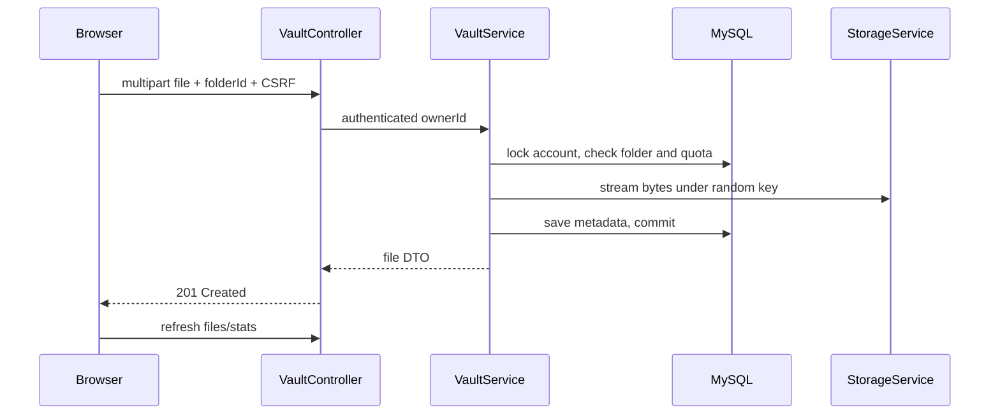

# Architecture and source walkthrough

## Request lifecycle

1. Spring Boot serves `index.html` and static assets on the same origin as REST endpoints. Spring Security redirects unauthenticated browser requests to `auth.html`; JSON API requests receive 401.
2. `common.js` obtains CSRF token from `/api/auth/csrf`, attaches it on mutations, sends session cookies, and reports errors. `app.js` translates hash navigation into state and API calls; it builds DOM nodes with `textContent` rather than interpolating untrusted HTML.
3. `AuthController` and `VaultController` receive request records and use the authenticated `VaultPrincipal.id` rather than a user-supplied owner ID. They delegate to services.
4. `AccountService` checks email and password, uses BCrypt, and generates one-time tokens. Tokens are securely random and stored as SHA-256 digests. Email is sent via local SMTP or Brevo HTTPS. Password change increments authVersion so old sessions are invalidated by the security filter.
5. `VaultService` checks ownership and demo restrictions, validates names, applies quota and file count limits, handles metadata, sharing and deletion. `VaultRepository` uses parameterized JPQL and EntityManager. `@Transactional` gives a database transaction around operations; locking account rows prevents concurrent same-account quota races.
6. `StorageService` writes random UUID keys, never user-controlled paths. Upload bytes stream from multipart data to disk/S3. The DB retains the filename and object key; bytes remain in external storage. `Download` opens a stream and the controller sends a safe Content-Disposition response.

## Upload flow

A failed database commit triggers best-effort deletion of the newly uploaded object. Permanent deletion removes bytes then DB metadata; an outage between them can leave inconsistent metadata. Empty trash purges one file per transaction, reducing all-or-nothing failure. A commercial design would use an outbox/deletion job and reconciliation, not treat remote object storage as part of a database transaction.

## Sharing workflow

The owner creates either a random bearer token (1–168 hours) or a grant attached to a recipient account. A public link uses `/share.html#token`; JS sends token to `/api/public/{token}`. The server hashes token and checks expiry and active file. Registered recipient downloads are checked against `recipientId` each time. Owner revokes the grant; soft deletion revokes all existing shares. Restoring the file does not restore shares.

## Code to learn first

| File | Explain in an interview |
|---|---|
| CloudVaultApplication.java | `@SpringBootApplication`, auto-configuration, main entry point |
| SecurityConfig.java | Session login, CSRF, public route allowlist, security headers, IP throttle |
| AccountService.java | Register, verify, reset, BCrypt and token expiry |
| VaultController.java | REST request mapping, multipart, status codes, streams |
| VaultService.java | Ownership, folder operations, quota, sharing and transaction boundaries |
| VaultRepository.java | EntityManager, typed JPQL, bind parameters, row locks |
| StorageService.java | Local/S3 backend selected by config, UUID object names, streams |
| common.js / app.js | Fetch, async/await, hash routing, DOM events, render real API state |
| compose.yaml / Dockerfile | Multi-stage image, health-based dependency, private network, volumes |

## Design trade-offs

Monolith instead of microservices; same-origin session instead of JWT; relational metadata instead of database BLOBs; one app instance, capped accounts and bounded listing rather than distributed search; no arbitrary script/SVG preview; empty folder deletion only; read-only demo for safety. Password reset is email-based, not 2FA. Email changes and account self-deletion are not included. For production add explicit foreign keys and migrations, durable queue, antivirus/quarantine, stricter abuse controls, monitoring, backup/restore and dependency updates. Do not claim encryption end-to-end: TLS and provider at-rest encryption are different from client-side encryption.
