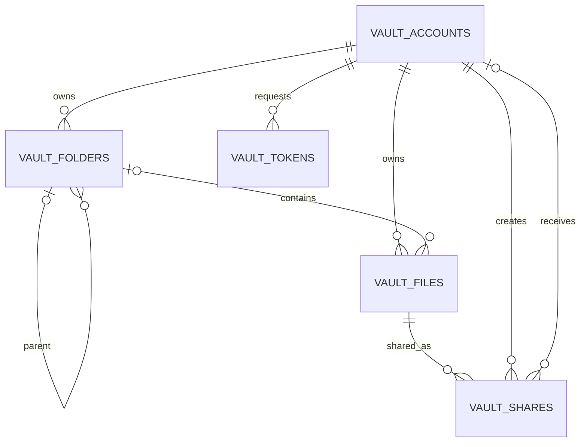

# Database design

MySQL 8.4 stores metadata; local disk or S3 stores bytes. The JPA entities are the executable schema source. Hibernate creates/updates tables (`ddl-auto=update`) for this educational project. `schema.sql` is a reference MySQL schema; not automatically executed. For a maintained production deployment, use versioned Flyway migrations and set schema validation instead of automatic updates.

| Table | Key data | Meaning |
|---|---|---|
| vault_accounts | id, email (unique), password_hash, verified, demo, auth_version | User identity and session invalidation |
| vault_folders | id, owner_id, parent_id, name, quick_access, opened_at | Nested workspace folders |
| vault_files | id, owner_id, folder_id, name, object_key (unique), mime_type, size_bytes, favorite, uploaded_at, deleted_at | File metadata; null deleted_at means active |
| vault_shares | id, file_id, owner_id, recipient_id, token_hash (unique), expires_at | Direct share or hashed link token |
| vault_tokens | id, account_id, token_hash (unique), purpose, expires_at | Single-use verification/reset token |

The implementation models references as scalar IDs and validates ownership at the service layer. The reference SQL matches the columns and indexes; Hibernate does not generate foreign-key constraints for these scalar ID mappings. Do not manually modify rows in a live database; production evolution should introduce explicit referential integrity and migration tests. A trash record retains the original folder reference so it can be restored. Empty folders only can be deleted. Quotas include both active and trashed files. Global limit is serialized in a single application instance and per-account mutations obtain pessimistic locks.
